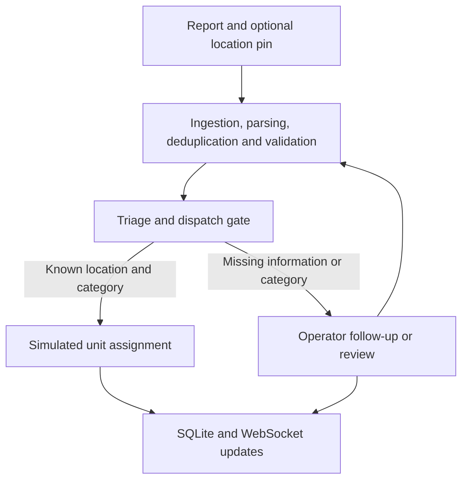

# AEGIS · Emergency Dispatch Simulator

AEGIS is a Delhi NCR emergency-response exercise built with FastAPI, LangGraph, React, Leaflet, WebSockets, and SQLite. It turns simulated English, Hindi, and Hinglish reports into an operator queue with location evidence, triage decisions, and simulated fleet assignments.

Use exercise transcripts, locations, and caller identities. The deployment model is a single API process with a simulated fleet and hospital inventory.

## What to demo

1. In the **SOS Portal**, load **Hinglish fire** and submit it. Open the **Control Room** to inspect the priority, assigned units, approximate landmark pin, and decision timeline.
2. Submit **Unknown location**. The report stays off the map and enters location follow-up. Open its incident card, enter a known landmark or choose **Select pin on map**, then save. The same incident ID receives the confirmed location and continues through triage and assignment.
3. Try **Sector 18** without a city, then use **Sector 18 Noida** as the callback detail. The qualified address maps to the Noida gazetteer entry.
4. In the WhatsApp simulator, send **Medical + Location** twice. The first report uses the shared coordinates throughout the pipeline. The second links to that report without assigning a second set of units.
5. Submit a mapped description with an unknown incident category, such as `Please help at Connaught Place.` Open the incident card and confirm a category for simulated dispatch. The operator decision appears in the timeline.
6. Resolve an assigned incident and watch the simulated fleet become available. Open **Exercise report** to inspect the recorded timeline and download JSON or print to PDF. Use dispatcher commands to ask for P1, fleet, and location follow-up counts.

## How it works



| Feature | Behavior |
| --- | --- |
| Location | Shared and operator-selected pins take precedence. The built-in gazetteer supplies approximate coordinates for matching Delhi NCR landmarks. Missing, ambiguous, and unsupported addresses stay unresolved. Saved legacy coordinates without provenance are kept off the map. |
| Multilingual intake | Text rules cover selected Hindi, English, and Hinglish phrases. Optional LLM suggestions are schema-validated, and the parser derives the map location from caller evidence. |
| Duplicate reports | Same-category candidates are checked within 1 km and 15 minutes using normalized text similarity or local multilingual embeddings when enabled. Closed incidents are removed from the candidate store. |
| Fleet | The dispatcher selects available units by straight-line distance. Pins outside the exercise area are displayed without simulated assignment. The queue records partial assignments and explicitly lists unfilled requests. Depot counts are derived from the same fleet state. |
| Routes | Both views use the assigned units' backend geometry. Straight-line estimates are dashed. With OSRM configured, a successful road route is solid. OSRM uses its estimated driving time and selection still uses depot distance. |
| Hospitals | Simulated hospital recommendations use recorded specialty and available beds. The app shows a capacity warning when it cannot find a match. |
| Reports | SQLite stores the transcript, decision timeline, location provenance, and final status. WebSocket snapshots restore the control room on reconnect. Exercise reports use recorded events and assignments. |
| Advisory agents | Suggested cascade risks and post-incident insights depend on the configured LLM. The MCI monitor uses observed simulated surges and fleet counts to summarize exercise conditions. |

## Run locally

Create a Python 3.11 or 3.12 environment, then start the API from the repository root.

```bash
python -m venv .venv
source .venv/bin/activate
pip install -r requirements.txt
AEGIS_DISABLE_LLM=1 AEGIS_DB_PATH=./aegis-demo.db uvicorn api.main:app --port 8000
```

Start the portal in a second terminal.

```bash
cd portal
npm ci
npm run dev
```

Open [the portal](http://localhost:5173) or [the API documentation](http://localhost:8000/docs). The `AEGIS_DB_PATH` example starts a separate exercise database. If you point the API to an existing database, it adds the incident payload column and reads existing records.

| Optional capability | Setup |
| --- | --- |
| LLM-assisted parsing, validation, and triage | Remove `AEGIS_DISABLE_LLM` from the launch command, set a provider key, and configure `LLM_PROVIDER` and its model. Check `/health` for initialization details. |
| Road geometry and ETA | Set `USE_MOCK_ROUTING=false` and optionally set `OSRM_BASE_URL` to a reachable OSRM service. Use synthetic coordinates with public routing endpoints. |
| Uploaded audio | Install the optional `openai-whisper` package and FFmpeg. The upload endpoint checks for a loaded model and a supported file type. Browser dictation uses the browser's speech recognition where available. |
| WhatsApp image messages | The mock webhook accepts a written image caption as incident evidence. |
| Hosted portal | Set `VITE_API_BASE_URL` during the frontend build, set `CORS_ORIGINS` on the API, and if needed set `VITE_WS_URL`. Configure persistent disk storage for SQLite when exercise data must survive redeploys. |

## Verify the implementation

```bash
AEGIS_DISABLE_LLM=1 python -m pytest tests -q
AEGIS_DISABLE_LLM=1 python -m evaluation.run_evals
cd portal
npm run build
```

The scenario evaluation checks expected category, priority, location provenance, and dispatch decision on 10 labeled synthetic cases. The tests exercise WhatsApp GPS ordering, duplicate suppression, callback continuity, operator review, WebSocket snapshots, fleet release, and exercise report generation. Results describe these fixtures and do not measure real-world dispatch accuracy.

**Portfolio description**

> Built a multilingual emergency dispatch simulator with LangGraph and FastAPI, implementing operator-confirmed geolocation, duplicate detection, simulated fleet assignment, and a real-time Leaflet control room. Added a reproducible evaluation suite and exportable decision timelines.
